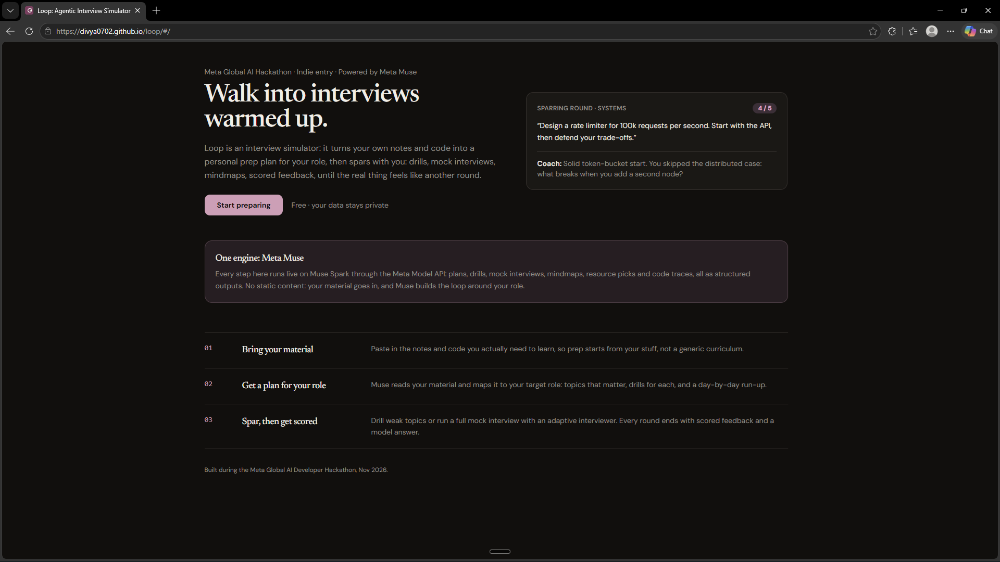
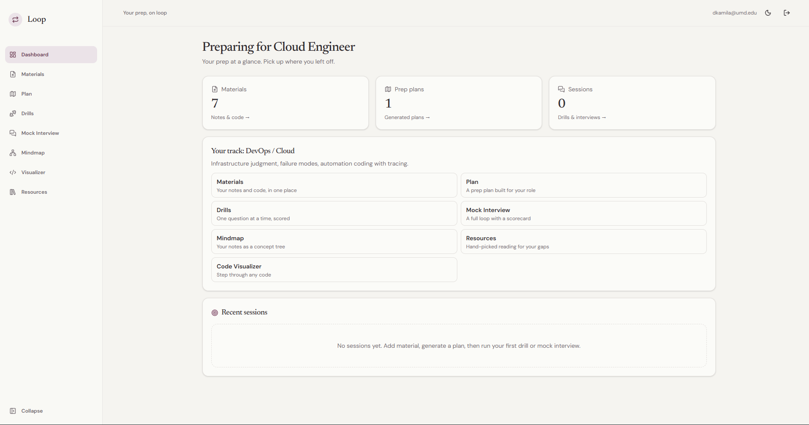
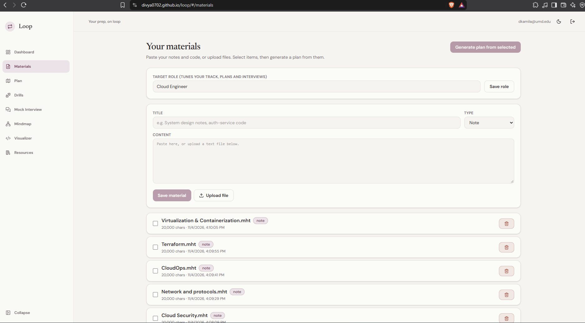
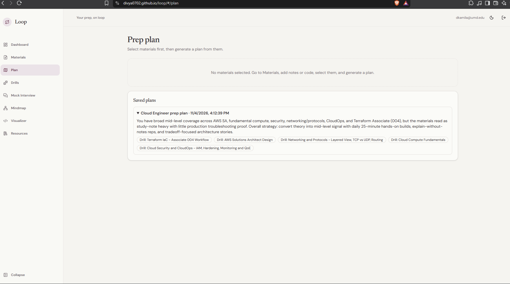
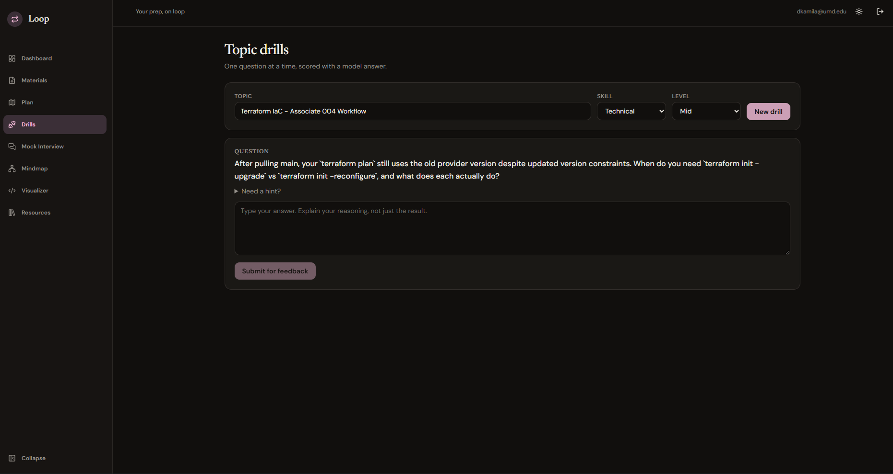
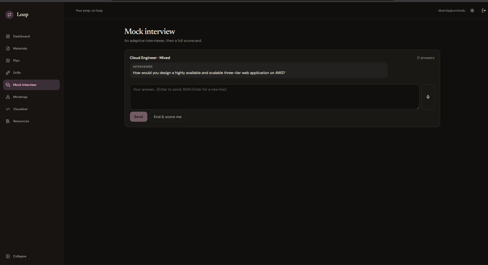
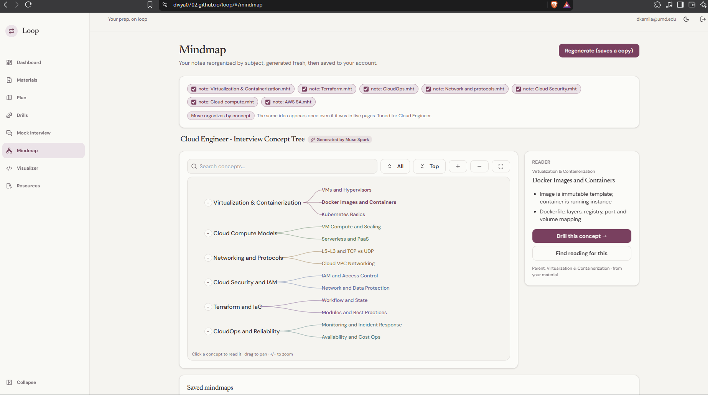
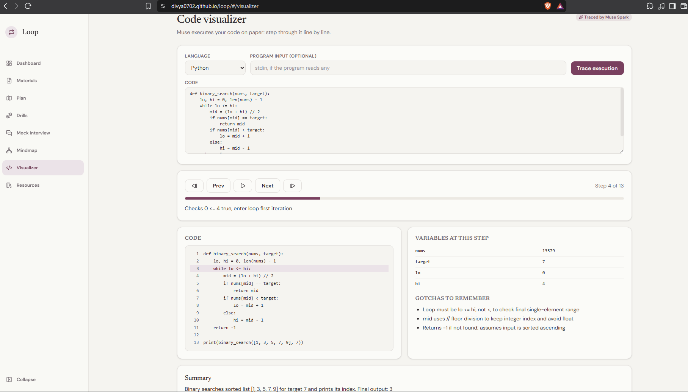
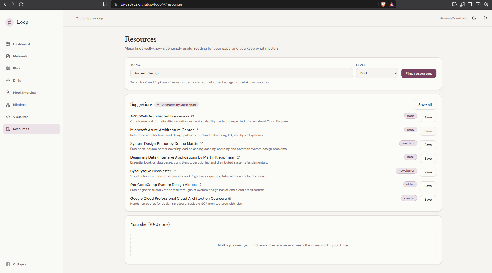

# Loop: Agentic Interview Simulator

Bring your own notes and code. Loop turns them into a prep plan built for your
target role, then spars with you: scored drills, adaptive mock interviews, an
interactive mindmap of your material, hand-picked reading, and a step-by-step
code tracer. Every AI step is a live call to Meta Muse Spark through the Meta
Model API.

Built during the **Meta Global AI Developer Hackathon** (Indie track, *Build for
Your World* theme).

<p align="center">
  
</p>

## Live demo

- **Live app:** https://divya0702.github.io/loop/#
- **Demo video (3 min):** https://youtu.be/Lzml8PeXlhA

To try it: sign up with any email and password. Email confirmation is turned off, so your account works instantly.

## Screenshots

The flow below uses a Cloud Engineer prep set as the example, end to end.

**Dashboard** — your prep at a glance: material, plan, and session counts, plus your role track.



**Materials** — paste notes and code, or upload text files, and set your target role.



**Plan** — Muse turns the selected materials into a saved, role-specific prep plan with drill topics.



**Drills** — one question at a time on a chosen topic, scored with feedback and a model answer.



**Mock interview** — an adaptive interviewer that ramps difficulty, with typed or voice answers.



**Mindmap** — your notes reorganized into an interactive concept tree you can search, expand, and drill from.



**Code visualizer** — step through code line by line with variable states and gotchas at each step.



**Resources** — Muse suggests well-known reading for a topic; save the best to your shelf and check them off.



## How it works

1. **Materials**: paste notes and code, or upload text files; set your target role.
2. **Plan**: Muse reads your materials and builds a role-specific plan (topics
   that matter, drills for each, a 5-day run-up, likely interview angles).
   Plans save to your account automatically.
3. **Drills**: one question at a time, scored with feedback and a model answer.
   Three styles: Technical, Behavioral (graded on STAR structure), Leadership.
4. **Mock interview**: an adaptive interviewer (typed or voice input in
   Chrome/Edge) that ramps difficulty, ending in a full scorecard: overall
   score, dimension ratings, strengths, improvements, hire signal.
5. **Mindmap**: Muse reorganizes your notes into an interactive concept tree.
   Expand and collapse branches, search concepts, read key points, and drill
   any node. Saved to your account.
6. **Code visualizer**: paste Python, JavaScript, TypeScript, Java, or Go.
   Muse traces execution line by line with variable states and gotchas.
7. **Resources**: Muse proposes genuinely useful, well-known resources for any
   topic. Save the best to your shelf and check them off as you finish.

Role tracks adapt the loop to you: frontend, backend, data/ML, and DevOps roles
get the code visualizer; manager and product roles get behavioral weight
instead. Light and dark themes included.

## Stack

React 19 + TypeScript + Tailwind CSS v4 (Vite, Hash routing) · Supabase
(Postgres, Auth, Edge Functions on Deno) · Meta Muse via the Meta Model API
(`https://api.meta.ai/v1`, default model `muse-spark-1.3`).

## How Meta AI is used

Every intelligent step is a separate live Muse call with structured JSON
output: plan generation, drill questions, answer grading, the interviewer,
interview scoring, mindmap generation, resource curation, and code tracing.
Token budgets are sized generously because Muse Spark is a reasoning model.

## Setup — run your own copy

Loop is a static frontend plus a Supabase backend. There is no custom server
to run: Supabase hosts the database and sign-in, and two Supabase Edge
Functions call Meta Muse on behalf of the app.

So to run your own copy you need **your own** free Supabase project and **your
own** Meta Model API key. Your users and data will be separate from the live
demo, and Row Level Security keeps each user's rows private.

### Just want to try it? (no setup)

Use the live demo instead: https://divya0702.github.io/loop/#

1. Open the link and sign up with any email and password.
2. Go to **Materials**, add a note, select it, and generate a plan.
3. Run a drill or a mock interview from the sidebar.

Nothing to install. Come back to the steps below only if you want to host
your own copy.

### Prerequisites

- [Git](https://git-scm.com/downloads)
- [Node.js 22](https://nodejs.org/) and npm (the version this repo's deploy uses)
- A free [Supabase](https://supabase.com) account
- A Meta Model API key (for Muse Spark via the Meta Model API)
- The [Supabase CLI](https://supabase.com/docs/guides/cli) (Step 4 only)

### Step 1 — Clone this repo and install dependencies

```bash
git clone https://github.com/divya0702/loop.git
cd loop
npm install
```

### Step 2 — Create your Supabase project and database

1. Create a new project at [supabase.com](https://supabase.com).
2. In the dashboard, open **SQL Editor** and run the full contents of these
   files, in this order. Each adds the tables for one feature area, with
   per-user Row Level Security already set up:
   - `supabase/migrations/0001_init.sql` — profiles, materials, plans, sessions
   - `supabase/migrations/0002_saved_resources.sql` — saved resources shelf
   - `supabase/migrations/0003_mindmaps.sql` — saved mindmaps
3. Open **Authentication → Providers** and confirm **Email** is enabled.
   This app is multi-user: each person signs up and only sees their own data.
4. Optional, to match the demo: under **Authentication** sign-in settings,
   turn off **Confirm email**. New accounts can then sign in immediately
   without an inbox round-trip.

### Step 3 — Give the Edge Functions your Meta API key

The AI calls run inside Supabase Edge Functions, not in the browser, so your
Meta key stays server-side. Set it as a secret on your project:

```bash
supabase secrets set MODEL_API_KEY=your-meta-model-api-key
# Optional overrides (defaults shown):
# supabase secrets set META_MODEL=muse-spark-1.3
# supabase secrets set META_API_BASE=https://api.meta.ai/v1
```

Run this after linking the CLI in Step 4, or set the same secret in the
dashboard under **Project Settings → Edge Functions → Secrets**.

> Never put `MODEL_API_KEY` in the frontend, in a `VITE_` variable, or in any
> committed file.

### Step 4 — Deploy the two Edge Functions

Install the [Supabase CLI](https://supabase.com/docs/guides/cli), then from
the repo root:

```bash
supabase login
supabase link --project-ref <your-project-ref>

supabase functions deploy generate-plan
supabase functions deploy coach
```

`<your-project-ref>` is the subdomain of your Project URL:
`https://<your-project-ref>.supabase.co`.

- `generate-plan` turns materials into a prep plan.
- `coach` handles drills, the mock interview, mindmaps, resources, and code tracing.

The pages will load without these functions, but every AI action will fail
until both are deployed and Step 3 is done.

### Step 5 — Connect the frontend to your Supabase project

Copy the example env file, then fill in your own values:

```bash
cp .env.local.example .env.local
```

On Windows PowerShell, use `Copy-Item .env.local.example .env.local` instead.

In **Project Settings → API** in the Supabase dashboard, copy:

| In Supabase | Goes into `.env.local` as |
| --- | --- |
| Project URL | `VITE_SUPABASE_URL` |
| Publishable / anon key | `VITE_SUPABASE_ANON_KEY` |

`.env.local` ends up looking like this:

```bash
VITE_SUPABASE_URL=https://<your-project-ref>.supabase.co
VITE_SUPABASE_ANON_KEY=<your-publishable-key>
```

The publishable key is safe to embed in the frontend: Row Level Security
isolates every user's rows. Never use the secret / `service_role` key here.
`.env.local` is gitignored — do not commit it.

### Step 6 — Run it locally and check it works

```bash
npm run dev
```

Open the URL Vite prints (usually http://localhost:5173), then verify the
full loop:

1. Sign up and sign in.
2. In **Materials**, paste a short note, save it, and select it.
3. Generate a plan, then open **Drills** and submit an answer.
4. Try the **Mindmap**, **Code visualizer**, and **Resources** pages.

If sign-in works but AI actions fail, re-check Steps 3 and 4.

### Step 7 — Optional: publish your copy on GitHub Pages

Pushing to `main` publishes the frontend via `.github/workflows/deploy.yml`:

1. Push or fork this repo to your own GitHub account.
2. **Settings → Environments → `github-pages`**: add `VITE_SUPABASE_URL` and
   `VITE_SUPABASE_ANON_KEY` as *environment* secrets, using the same values
   as your `.env.local`.
3. **Settings → Pages → Source**: set to **GitHub Actions**.
4. Push to `main` (or run the workflow manually) and open the Pages URL it publishes.

Notes for forks:

- A production build is just `npm run build`; the static output in `dist/`
  can be hosted on any static host, not only GitHub Pages.
- `.github/workflows/deploy-functions.yml` can redeploy the Edge Functions
  from GitHub Actions, but it is written for this repo's project. If you fork,
  update `SUPABASE_PROJECT_REF` in that file and add a `SUPABASE_ACCESS_TOKEN`
  Actions secret, or simply keep deploying with the CLI from Step 4.

### Troubleshooting

- **Sign-in fails or the app says Supabase is not configured** — check the two
  values in `.env.local`, then restart `npm run dev`. Vite only reads env
  files at startup.
- **Sign-up asks you to confirm your email first** — turn off **Confirm email**
  in Supabase Auth settings (Step 2.4), or click the confirmation link.
- **Plans, drills, or other AI actions error** — both Edge Functions must be
  deployed (Step 4) and `MODEL_API_KEY` must be set on the project (Step 3).
- **Saving materials, plans, or mindmaps fails** — re-run the three migration
  files from Step 2, in order, in the SQL Editor.
- **Changed `.env.local` but nothing changed** — stop and restart `npm run dev`.

## Project structure

```
src/
  App.tsx              routing shell
  components/
    ui.tsx             small shared primitives
    layout/            sidebar (collapsible), topbar, theme toggle
  features/
    landing/           public home page
    auth/              sign in / sign up + session provider
    dashboard/         role track, counts, recent sessions
    materials/         paste/upload notes & code, target role
    plan/              generate + auto-save role-specific plans
    practice/          drills (technical / behavioral / leadership)
    interview/         adaptive mock interviewer + scorecard
    mindmap/           interactive Muse mindmap of your notes
    visualizer/        step-through code tracer
    resources/         Muse resource finder + saved shelf
  lib/
    supabaseClient.ts
    coach.ts           typed edge-function callers
    tracks.ts          role-aware module tracks
  hooks/
    useDarkMode.ts     light/dark theme, persisted
supabase/
  migrations/          0001 init, 0002 resources, 0003 mindmaps (+ RLS)
  functions/
    _shared/meta.ts    Meta Model API client
    generate-plan/     materials -> prep plan
    coach/             drills, interview, mindmap, resources, tracing
screenshots/           app screenshots used in this README
```

## License

MIT. See [LICENSE](LICENSE).
